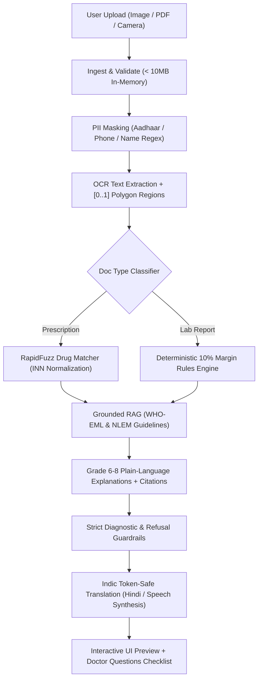

# Samjho — Grounded Plain-Language Health Document Explainer

[](LICENSE)
[]()
[]()

> **One-Line Pitch:** Upload a prescription or lab report and get a plain-language explanation in your own language, with every statement traced back to its public source. Information only. Never a diagnosis.

Built for the **Open Clinical Hackathon (Healthcare Literacy & Patient Agency Track)**. Designed for elderly patients, rural families, multi-lingual caregivers in India, and clinical reviewers.

---

## 1. Quickstart (Under 5 Commands)

```bash
# 1. Clone & Enter Directory
cd "MED-PROJECT"

# 2. Run Fullstack via Docker Compose
docker-compose up --build

# OR Run Locally without Docker:
# 3a. Start Backend (Terminal 1)
cd backend && pip install -r requirements.txt && uvicorn app.main:app --port 8000

# 3b. Start Frontend (Terminal 2)
cd frontend && npm install && npm run dev
```

Visit the frontend at **`http://localhost:5173`** and the interactive FastAPI OpenAPI documentation at **`http://localhost:8000/docs`**.

---

## 2. Running Evaluation & Benchmarks

```bash
# Run the 24-case pytest unit test suite (Rules, Guardrails, PII Masking, RapidFuzz)
cd backend && python -m pytest tests/

# Generate 25 synthetic benchmark documents and run the empirical evaluation harness
python app/scripts/make_synthetic_docs.py
python eval/run_eval.py
```

Benchmark output is logged in [`backend/eval/REPORT.md`](backend/eval/REPORT.md).

---

## 3. Visual & Front-End Design System

Samjho intentionally avoids AI clichés (no purple/neon gradients, no glassmorphism, no robots, no sparkle icons). It delivers a tactile, medical stationery and pharmacy label aesthetic:
- **Palette**:
  - Warm Off-White Paper: `#F3EEE3`
  - Near-Black Carbon Ink: `#1B1A17`
  - Hairline Medical Rules: `#D9D1BF`
  - Vermilion Pointer & Focus Accent: `#C8432B`
  - Normal Range Sage: `#5E7A5A`
  - Caution Ochre: `#C99A2E`
- **Typography**: Display: *Fraunces*, Monospace & Scramble: *JetBrains Mono*, Body: *Instrument Sans*.
- **Custom Cursor**: Desktop-only lerp easing dot + 36px ring with context-aware states (`DROP`, `UPLOAD`, `SOURCE`, `TEXT`, `LINK`). Zero-lag mode when `prefers-reduced-motion` is detected.
- **Scramble Text**: Custom layout-stable scrambler resolving glyphs `▒░#%&@01<>/\\` with zero cumulative layout shift (CLS).

---

## 4. End-to-End Architecture



---

## 5. Connecting Frontend to Backend

The frontend defaults to instant offline simulation using rich synthetic documents (`SAMPLE_PRESCRIPTION` and `SAMPLE_LAB_REPORT`). 

To connect to the live FastAPI backend:
1. Ensure the backend is running (`http://localhost:8000`).
2. Set `VITE_API_URL=http://localhost:8000` in `frontend/.env`.
3. The frontend service `src/services/analyzeDocument.ts` automatically detects the live API and routes multipart uploads to `/v1/analyze`, falling back gracefully to local synthetic simulation if the server is unreachable.

---

## 6. Placeholders & Assumptions to Verify Before Production

| Item | Current Value / Implementation | Action Required Before Real-World Clinical Deployment |
| :--- | :--- | :--- |
| **Knowledge Base Scope** | 30 medicines, 20 lab investigations | Expand to full National Formulary of India (NFI) & CDSCO schedule |
| **"Slightly Outside" Bound** | 10% threshold of nearest bound | Calibrate threshold per test with institutional pathology committee |
| **Handwriting OCR** | PaddleOCR + Verification Gate (<65%) | Benchmark against specialized Indian handwritten script VLM checkpoints |
| **Translation Engine** | Token-protected phrase mapper + Web Speech | Connect to fine-tuned IndicTrans2 inference server for all 22 scheduled languages |
| **Clinical Review** | Audit protocol provided in `eval/` | Conduct 20-case independent clinician sign-off with registered practitioners |

---

## 7. Data Statement

**100% Synthetic Data Only.** No real patient names, prescriptions, or laboratory reports were used or collected during the development of this prototype. All demo cases represent programmatically synthesized clinical stationery.
